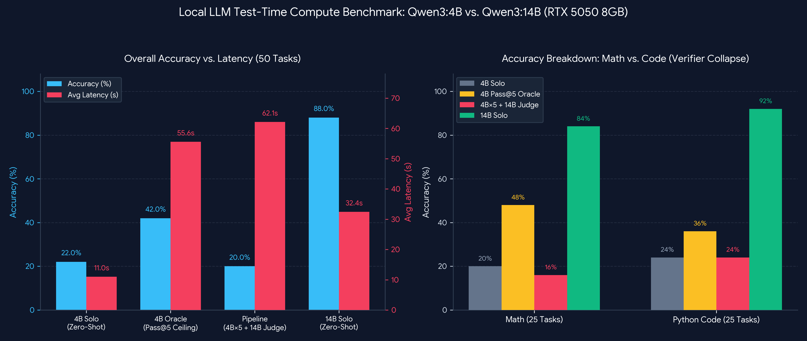
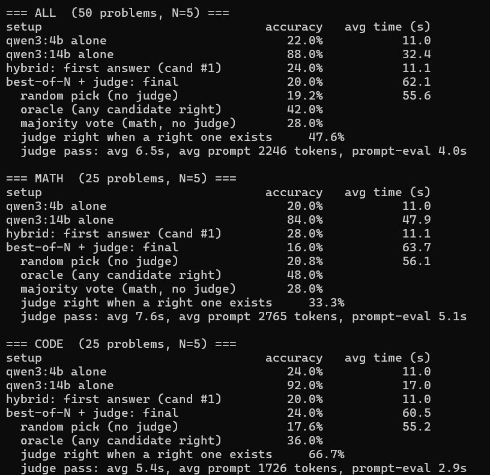
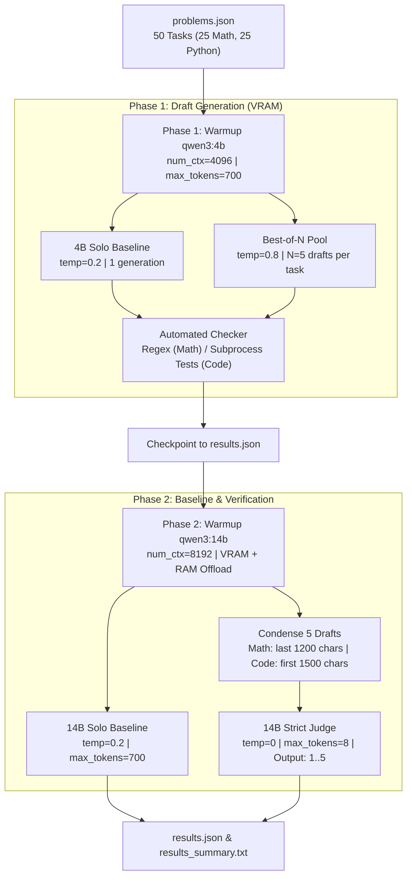
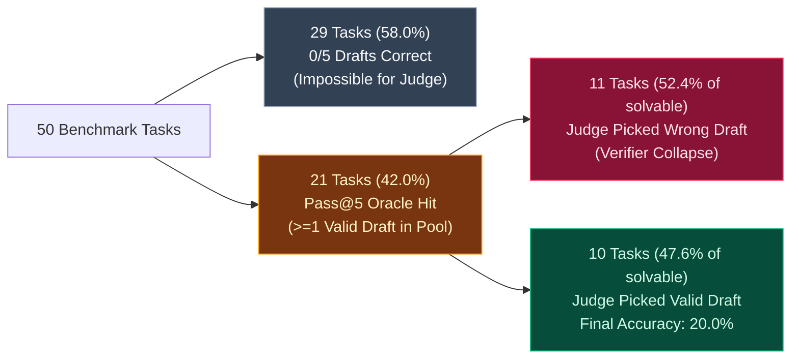

<div align="center">

<h1>Local Best-of-N Benchmark (Qwen3:4B vs. Qwen3:14B)</h1>

<p>
  <strong>Empirical evaluation of a Generator–Judge (Test-Time Compute) pipeline vs. monolithic zero-shot inference on consumer 8 GB VRAM hardware.</strong>
</p>

<p>
  
  
  
  
</p>

<p>
  <a href="#key-results">Key Results</a> •
  <a href="#pipeline-architecture">Architecture</a> •
  <a href="#failure-analysis">Failure Analysis</a> •
  <a href="#full-benchmark-telemetry">Telemetry</a> •
  <a href="#quickstart">Quickstart</a>
</p>

</div>

<hr />

<h2 id="overview">Overview</h2>

<p>
  A common inference-scaling hypothesis is that pairing a fast, small generator (drafting <code>N</code> candidates) with a larger evaluator (selecting the best draft) can match or outperform the larger model running solo while saving compute.
</p>

<p>
  This benchmark tests that pattern locally across <strong>50 deterministic tasks</strong> (25 math reasoning problems + 25 Python coding tasks with automated unit tests) using <strong>Ollama</strong> on an <strong>8 GB RTX 5050</strong> with 24 GB system RAM. Instead of improving efficiency, the <code>Qwen3:4B (N=5) + Qwen3:14B Judge</code> pipeline dropped accuracy by <strong>68 percentage points</strong> while taking <strong>1.9× longer</strong> than running <code>Qwen3:14B</code> zero-shot.
</p>

<h2 id="key-results">Key Results</h2>

<div align="center">
  
</div>

<br />

<table>
  <thead>
    <tr>
      <th align="left">Setup</th>
      <th align="right">Overall Accuracy</th>
      <th align="right">Math (25)</th>
      <th align="right">Code (25)</th>
      <th align="right">Avg Latency / Task</th>
    </tr>
  </thead>
  <tbody>
    <tr>
      <td><strong><code>qwen3:14b</code> Solo (Zero-Shot)</strong></td>
      <td align="right"><strong>88.0%</strong></td>
      <td align="right"><strong>84.0%</strong></td>
      <td align="right"><strong>92.0%</strong></td>
      <td align="right"><strong>32.4s</strong></td>
    </tr>
    <tr>
      <td><code>qwen3:4b</code> Solo (Zero-Shot, temp=0.2)</td>
      <td align="right">22.0%</td>
      <td align="right">20.0%</td>
      <td align="right">24.0%</td>
      <td align="right">11.0s</td>
    </tr>
    <tr>
      <td>Hybrid: First Draft (Candidate #1, temp=0.8)</td>
      <td align="right">24.0%</td>
      <td align="right">28.0%</td>
      <td align="right">20.0%</td>
      <td align="right">11.1s</td>
    </tr>
    <tr>
      <td>4B Pass@5 Oracle (Any Candidate Right)</td>
      <td align="right">42.0%</td>
      <td align="right">48.0%</td>
      <td align="right">36.0%</td>
      <td align="right">55.6s <em>(drafting only)</em></td>
    </tr>
    <tr>
      <td><strong>Best-of-5 + <code>qwen3:14b</code> Judge (Final)</strong></td>
      <td align="right"><strong>20.0%</strong></td>
      <td align="right"><strong>16.0%</strong></td>
      <td align="right"><strong>24.0%</strong></td>
      <td align="right"><strong>62.1s</strong></td>
    </tr>
    <tr>
      <td>Majority Vote (Math Only, No Judge)</td>
      <td align="right">—</td>
      <td align="right">28.0%</td>
      <td align="right">—</td>
      <td align="right">56.1s</td>
    </tr>
  </tbody>
</table>

<details>
  <summary><strong>View Raw Terminal Summary Screenshot (88.9 min run)</strong></summary>
  <br />
  <div align="center">
    
  </div>
</details>

<hr />

<h2 id="pipeline-architecture">Pipeline Architecture</h2>

<p>
  To avoid thrashing 8 GB VRAM with repeated model loads on every question, <code>run_benchmark.py</code> executes in two batched phases with <code>keep_alive="30m"</code> and <code>think=False</code> across all runs.
</p>



<hr />

<h2 id="failure-analysis">Failure Analysis: Why the Pipeline Collapsed</h2>



<h3>1. Low Generator Ceiling &amp; 700-Token Truncation</h3>
<p>
  Even with 5 samples per task at <code>temp=0.8</code>, <code>qwen3:4b</code> produced at least one correct solution on only <strong>42.0%</strong> of tasks (21/50). Inspection of <code>results.json</code> reveals a key reason: despite passing <code>"think": false</code> to Ollama, <code>qwen3:4b</code> still generated verbose internal reasoning monologues that repeatedly hit the <code>700</code>-token ceiling before emitting a final answer or closing its Python code block. Because a verifier cannot recover ground truth that is never sampled, the pipeline was hard-capped at 42.0% from the start.
</p>

<h3>2. Verifier Collapse &amp; Strong Recency Bias</h3>
<p>
  When a valid draft <em>was</em> present in the 5-candidate pool, <code>qwen3:14b</code> isolated it only <strong>47.6% of the time</strong> (10/21)—dropping to <strong>33.3%</strong> on Math (4/12) and <strong>66.7%</strong> on Code (6/9). On Math, simple judge-free majority voting (28.0%) and even a random pick (20.8%) beat the 14B Judge (16.0%).
</p>

<p>
  Across all 50 tasks, the judge exhibited severe <strong>last-position (recency) bias</strong> when forced to pick among long, noisy candidates (avg 2,246 prompt tokens; 2,765 on Math):
</p>

<table>
  <thead>
    <tr>
      <th align="left">Candidate Slot Picked by 14B Judge</th>
      <th align="right">Math (25)</th>
      <th align="right">Code (25)</th>
      <th align="right">Total (50)</th>
      <th align="right">Share</th>
    </tr>
  </thead>
  <tbody>
    <tr>
      <td>Candidate #1</td>
      <td align="right">4</td>
      <td align="right">5</td>
      <td align="right">9</td>
      <td align="right">18.0%</td>
    </tr>
    <tr>
      <td>Candidate #2</td>
      <td align="right">1</td>
      <td align="right">3</td>
      <td align="right">4</td>
      <td align="right">8.0%</td>
    </tr>
    <tr>
      <td>Candidate #3</td>
      <td align="right">2</td>
      <td align="right">2</td>
      <td align="right">4</td>
      <td align="right">8.0%</td>
    </tr>
    <tr>
      <td>Candidate #4</td>
      <td align="right">1</td>
      <td align="right">1</td>
      <td align="right">2</td>
      <td align="right">4.0%</td>
    </tr>
    <tr>
      <td><strong>Candidate #5 (Last in Prompt)</strong></td>
      <td align="right"><strong>17</strong></td>
      <td align="right"><strong>14</strong></td>
      <td align="right"><strong>31</strong></td>
      <td align="right"><strong>62.0%</strong></td>
    </tr>
  </tbody>
</table>

<h3>3. Latency &amp; Memory Spillover Overhead</h3>
<p>
  Generating 5 sequential drafts on <code>qwen3:4b</code> consumed <strong>55.6s/task</strong>. Appending the <code>qwen3:14b</code> judge pass added another <strong>6.5s/task</strong> (4.0s prompt evaluation over ~2,246 tokens), bringing the pipeline total to <strong>62.1s/task</strong>. On Code specifically, <code>qwen3:14b</code> solo solved 92.0% of tasks in just <strong>17.0s/task</strong>—3.6× faster and 68 percentage points more accurate than the pipeline (24.0% in 60.5s).
</p>

<hr />

<h2 id="full-benchmark-telemetry">Full Benchmark Telemetry</h2>

<details open>
  <summary><strong>Domain-Level Metrics (from <code>results_summary.txt</code>)</strong></summary>
  <br />
  <table>
    <thead>
      <tr>
        <th align="left">Metric</th>
        <th align="right">ALL (50)</th>
        <th align="right">MATH (25)</th>
        <th align="right">CODE (25)</th>
      </tr>
    </thead>
    <tbody>
      <tr>
        <td><code>qwen3:4b</code> alone</td>
        <td align="right">22.0% (11.0s)</td>
        <td align="right">20.0% (11.0s)</td>
        <td align="right">24.0% (11.0s)</td>
      </tr>
      <tr>
        <td><code>qwen3:14b</code> alone</td>
        <td align="right"><strong>88.0% (32.4s)</strong></td>
        <td align="right"><strong>84.0% (47.9s)</strong></td>
        <td align="right"><strong>92.0% (17.0s)</strong></td>
      </tr>
      <tr>
        <td>Hybrid: first answer (cand #1)</td>
        <td align="right">24.0% (11.1s)</td>
        <td align="right">28.0% (11.1s)</td>
        <td align="right">20.0% (11.0s)</td>
      </tr>
      <tr>
        <td>Best-of-N + judge: final</td>
        <td align="right">20.0% (62.1s)</td>
        <td align="right">16.0% (63.7s)</td>
        <td align="right">24.0% (60.5s)</td>
      </tr>
      <tr>
        <td>Random pick (no judge)</td>
        <td align="right">19.2% (55.6s)</td>
        <td align="right">20.8% (56.1s)</td>
        <td align="right">17.6% (55.2s)</td>
      </tr>
      <tr>
        <td>Oracle (any candidate right)</td>
        <td align="right">42.0%</td>
        <td align="right">48.0%</td>
        <td align="right">36.0%</td>
      </tr>
      <tr>
        <td>Majority vote (math, no judge)</td>
        <td align="right">28.0%</td>
        <td align="right">28.0%</td>
        <td align="right">—</td>
      </tr>
      <tr>
        <td>Judge accuracy when &ge;1 valid draft exists</td>
        <td align="right">47.6%</td>
        <td align="right">33.3%</td>
        <td align="right">66.7%</td>
      </tr>
      <tr>
        <td>Judge pass avg time / prompt tokens / eval</td>
        <td align="right">6.5s / 2246 tok / 4.0s</td>
        <td align="right">7.6s / 2765 tok / 5.1s</td>
        <td align="right">5.4s / 1726 tok / 2.9s</td>
      </tr>
    </tbody>
  </table>
</details>

<hr />

<h2 id="repository-structure">Repository Structure</h2>

<table>
  <thead>
    <tr>
      <th align="left">File</th>
      <th align="left">Description</th>
    </tr>
  </thead>
  <tbody>
    <tr>
      <td><code>run_benchmark.py</code></td>
      <td>Zero-dependency Python runner (stdlib only) orchestrating Phase 1 drafting, Phase 2 judging/baselines, subprocess code testing, checkpointing, and summary reporting.</td>
    </tr>
    <tr>
      <td><code>problems.json</code></td>
      <td>50 benchmark tasks: <code>m01</code>–<code>m25</code> (combinatorics, number theory, algebra, arithmetic) and <code>c01</code>–<code>c25</code> (Python algorithmic problems with <code>assert</code> test suites).</td>
    </tr>
    <tr>
      <td><code>results.json</code></td>
      <td>Full per-task telemetry including raw outputs, token counts, wall-clock timings, load durations, prompt-eval latency, and correctness flags.</td>
    </tr>
    <tr>
      <td><code>results_summary.txt</code></td>
      <td>Aggregated accuracy and latency tables across ALL, MATH, and CODE splits.</td>
    </tr>
    <tr>
      <td><code>benchmark_chart.png</code></td>
      <td>Dual-panel visualization comparing accuracy vs. latency and domain-level verifier collapse.</td>
    </tr>
    <tr>
      <td><code>terminal_summary.png</code></td>
      <td>Raw CLI screenshot from the 88.9-minute local run.</td>
    </tr>
  </tbody>
</table>

<hr />

<h2 id="quickstart">Quickstart</h2>

<h3>Prerequisites</h3>
<ul>
  <li>Python 3.10+ (no <code>pip install</code> required—uses Python standard library only)</li>
  <li><a href="https://ollama.com/">Ollama</a> running locally (default: <code>http://localhost:11434</code>)</li>
</ul>

```bash
# 1. Pull the models
ollama pull qwen3:4b
ollama pull qwen3:14b

# 2. Quick sanity check (10 tasks: 5 math, 5 code)
python run_benchmark.py --limit 10

# 3. Full 50-task benchmark
python run_benchmark.py

# 4. Resume an interrupted run from results.json
python run_benchmark.py --resume

# 5. Force the 14B judge/baseline onto CPU/RAM only
python run_benchmark.py --judge-num-gpu 0
```

<h3>CLI Options</h3>

<table>
  <thead>
    <tr>
      <th align="left">Flag</th>
      <th align="left">Default</th>
      <th align="left">Description</th>
    </tr>
  </thead>
  <tbody>
    <tr>
      <td><code>--problems</code></td>
      <td><code>problems.json</code></td>
      <td>Path to the benchmark problem set JSON.</td>
    </tr>
    <tr>
      <td><code>--out</code></td>
      <td><code>results.json</code></td>
      <td>Output path for checkpointed telemetry JSON.</td>
    </tr>
    <tr>
      <td><code>--draft-model</code></td>
      <td><code>qwen3:4b</code></td>
      <td>Ollama model tag used for drafting and small baseline.</td>
    </tr>
    <tr>
      <td><code>--big-model</code></td>
      <td><code>qwen3:14b</code></td>
      <td>Ollama model tag used for judging and large baseline.</td>
    </tr>
    <tr>
      <td><code>--n</code></td>
      <td><code>5</code></td>
      <td>Number of candidate drafts generated per task.</td>
    </tr>
    <tr>
      <td><code>--draft-temp</code></td>
      <td><code>0.8</code></td>
      <td>Sampling temperature for the Best-of-N candidate pool.</td>
    </tr>
    <tr>
      <td><code>--max-tokens</code></td>
      <td><code>700</code></td>
      <td><code>num_predict</code> token cap per generation.</td>
    </tr>
    <tr>
      <td><code>--draft-ctx</code> / <code>--big-ctx</code></td>
      <td><code>4096</code> / <code>8192</code></td>
      <td>Context window sizes for draft and big models.</td>
    </tr>
    <tr>
      <td><code>--judge-num-gpu</code></td>
      <td><code>-1</code></td>
      <td>GPU layer offload for the big model (<code>-1</code> = Ollama auto, <code>0</code> = CPU/RAM only).</td>
    </tr>
    <tr>
      <td><code>--skip-big-alone</code></td>
      <td><code>False</code></td>
      <td>Skip the solo 14B baseline to shorten runtime.</td>
    </tr>
    <tr>
      <td><code>--resume</code></td>
      <td><code>False</code></td>
      <td>Resume from an existing <code>results.json</code> without re-running completed tasks.</td>
    </tr>
  </tbody>
</table>

<blockquote>
  <strong>Security Note:</strong> Coding tasks (<code>c01</code>–<code>c25</code>) execute model-generated Python directly on the host machine inside a temporary subprocess with a 10-second timeout. Run inside a container or isolated environment if evaluating untrusted models.
</blockquote>

<hr />

<div align="center">
  <p>Built and benchmarked locally by <a href="https://github.com/Solivagus17">Solivagus17</a></p>
</div>
